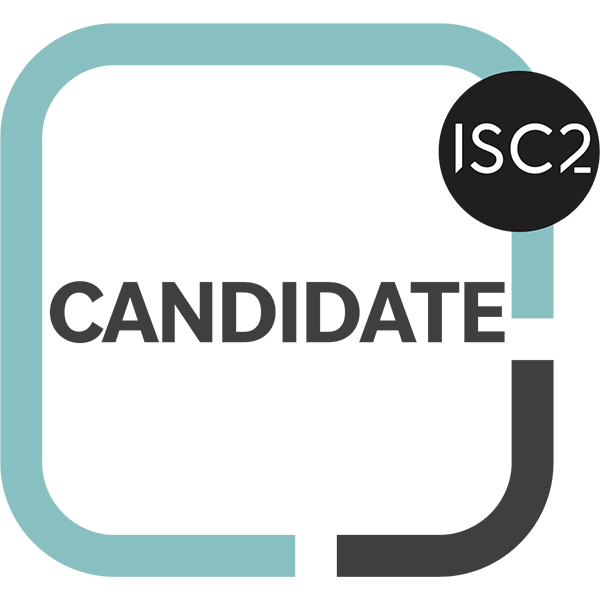
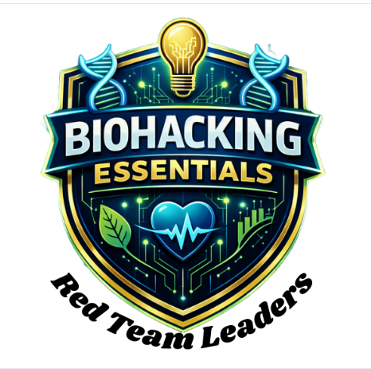
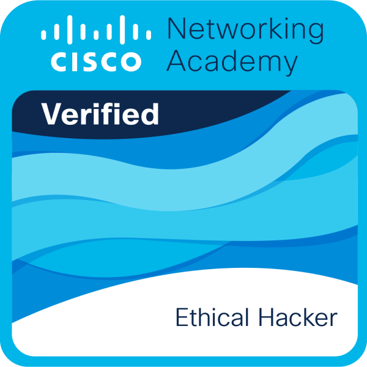
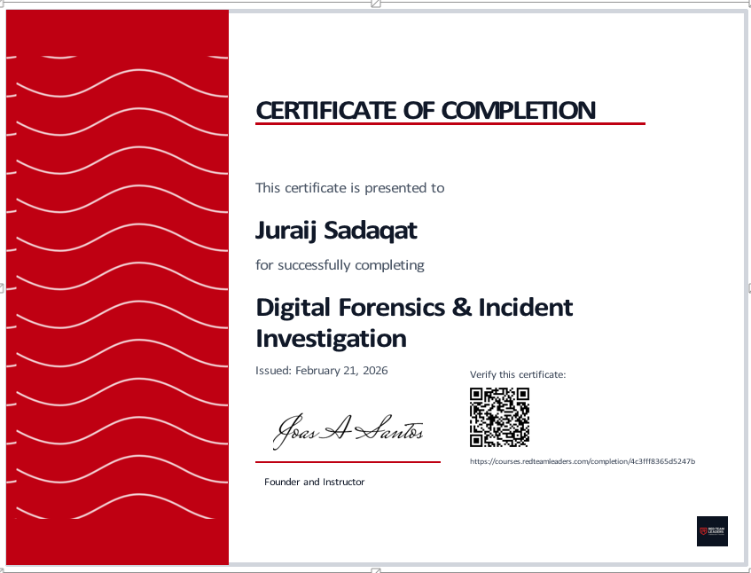
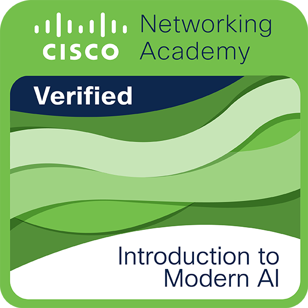
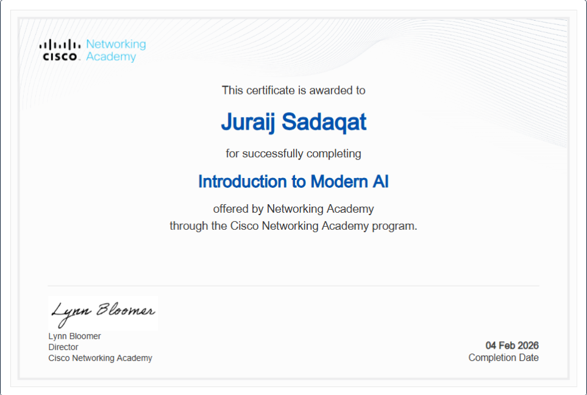
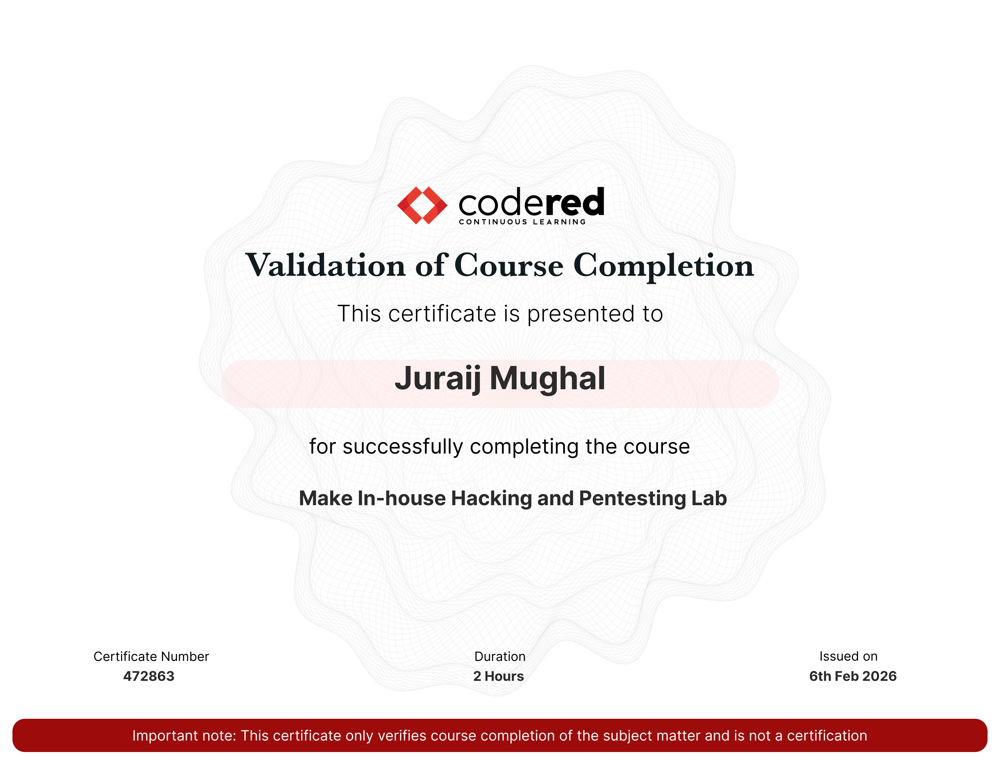
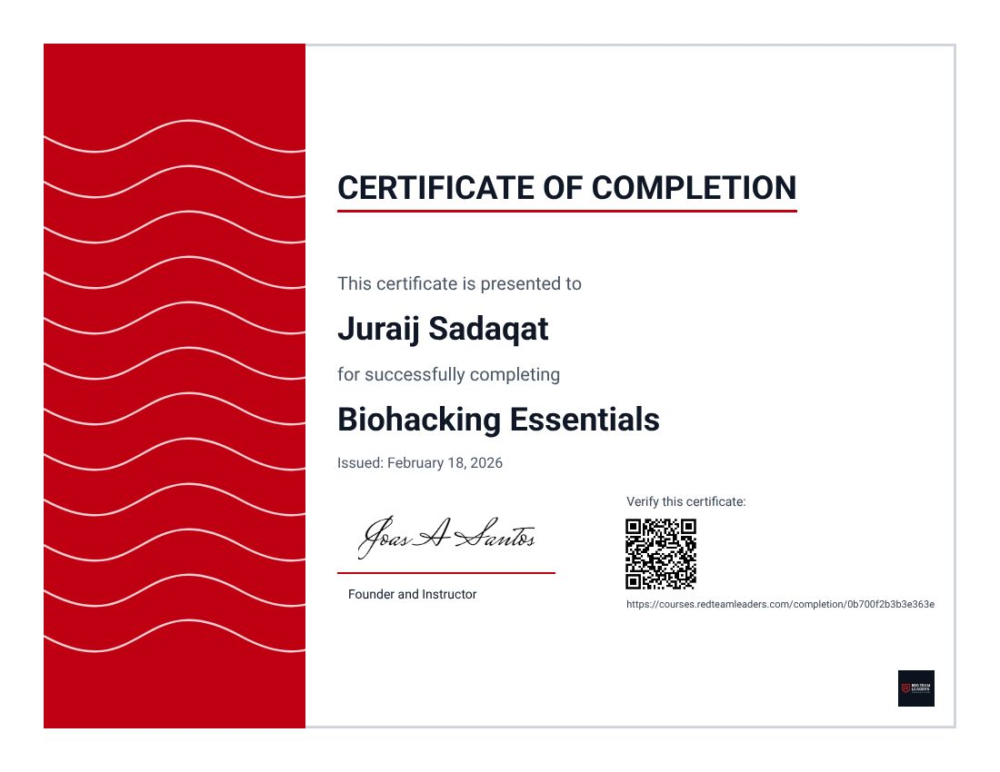
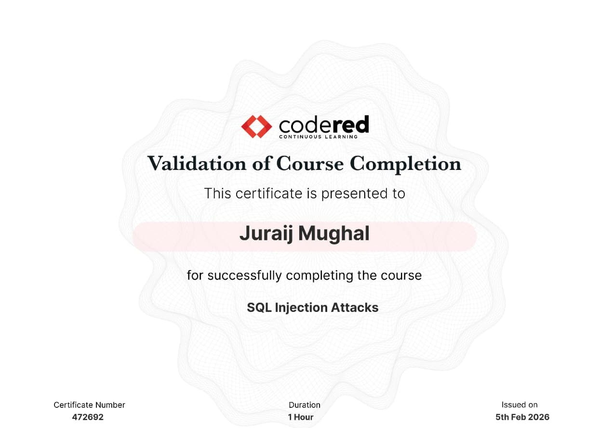
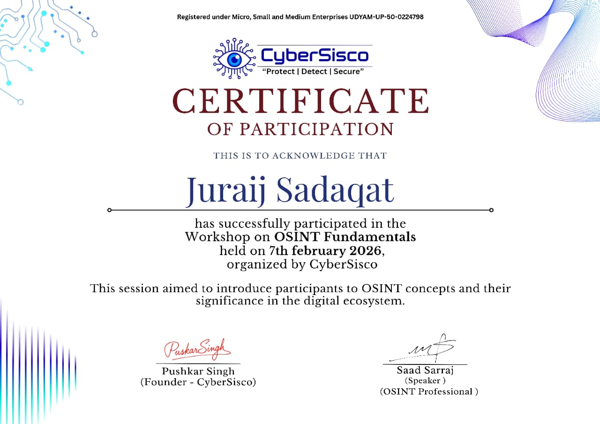

<div align="center">


# >_ Juraij Sadaqat

### Cybersecurity | Ethical Hacking


</div>

---

```bash
$ whoami
juraij_sadaqat

$ cat identity.txt
Name        : Juraij Sadaqat
Alias       : VulnerabilityHunter_786
Role        : Red Team Operator | Ethical Hacker | Cyber Researcher
Status      : ONLINE
Location    : Pakistan
Focus       : Web Application Penetration Testing | Bug Bounty Hunting
```

---

## About

Hi, I'm Juraij Sadaqat, a cybersecurity freelancer. I help find and fix security weaknesses in web applications, and I provide clear reports with practical fix recommendations.

## What I do

- Web Application Penetration Testing
- OWASP Top 10 Vulnerability Assessment
- SQL Injection, XSS, CSRF and IDOR testing
- API Security Testing
- Bug Bounty Hunting

I provide detailed reports with fix recommendations for the issues I find.

## Fiverr

I offer my cybersecurity services on Fiverr as **juraijmughal378**.

[View my Fiverr gig](http://www.fiverr.com/s/K332K9Y)

## Currently learning

- CSC-531 Data Structures & Algorithms — Section B
- Cybersecurity
- Computer vision

---

## Internship

```python
class Juraij:
    def __init__(self):
        self.name = "Juraij Sadaqat"
        self.role = "Red Team Operator"
        self.internship = "Cyberster Red Team Internship"
        self.skills = ["Active Directory", "Web Pentesting & Bug Hunting", "OSINT", "Network Exploitation", "Kerberos"]
        self.languages = ["Python", "C++", "Bash"]
        self.motto = "Every system has a weakness — find it before the bad guys do."
        self.mission = "Advanced Persistence & Domain Dominance"
```

**Cyberster Red Team Internship** — Red Team Internship at Cyberster, focused on Active Directory, Web Pentesting & Bug Hunting, OSINT, Network Exploitation and Kerberos.

---

## breach_log.txt

| # | Project | Description | Status |
|---|---------|-------------|--------|
| 01 | Red Team Infrastructure | Full AD lab with DC, workstations & attack box | ✅ Operational |
| 02 | Web Pentest Framework | Automated recon + vulnerability scanner | ✅ Operational |
| 03 | OSINT Toolkit | Username/email/domain intelligence gathering | ✅ Operational |
| 04 | Kerberos Attack Suite | AS-REP Roasting, Kerberoasting & Pass-the-Ticket | ✅ Operational |
| 05 | C2 Framework | Custom command & control with encrypted channels | 🔒 Classified |

---

## Skill Scan

```
Red Team Operations      ████████████████████ 95%
Web Penetration Testing  ██████████████████░░ 90%
Active Directory         █████████████████░░░ 85%
OSINT & Investigation    ██████████████████░░ 88%
Network Exploitation     ████████████████░░░░ 80%
Python / C++ / Bash      █████████████████░░░ 85%
```

### Toolkit


---

## Certificates


- **ISC2 Candidate**
- **OPSWAT Introduction to Critical Infrastructure Protection (ICIP)** — via Credly
- Red Team Leader
- Ethical Hacking
- Forensics
- AI
- Modern AI
- Investigation
- Penetration Lab
- Biohacking Essential
- SQL Injection
- Workshop

### Certificate images

| Certificate | Certificate |
|-------------|-------------|
|  |  |
|  |  |
|  |  |
|  |  |
|  |  |
|  | |

---

## The Game

```bash
while true; do
  echo "Learning... Hacking... Securing..."
  sleep 1
done
```

<div align="center">


</div>

---

## Connect

[](https://www.linkedin.com/in/juraij-sadaqat-b92a4939a)
[](https://juraij-cyber-portfolio.vercel.app/)
[](https://x.com/juraijmughal_78)
[](https://www.instagram.com/vulnerabilityhunter_786/)
[](mailto:juraijmughal378@gmail.com)

---

> "Every system has a weakness — find it before the bad guys do."
>
> **— Juraij Sadaqat**

```bash
$ exit
# Session terminated. Stay secure. 🔒
```
